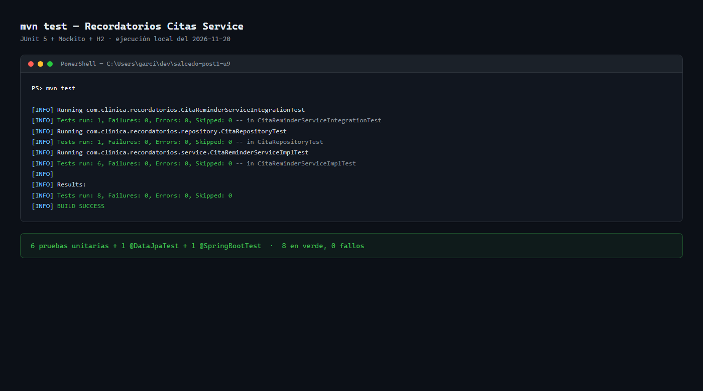
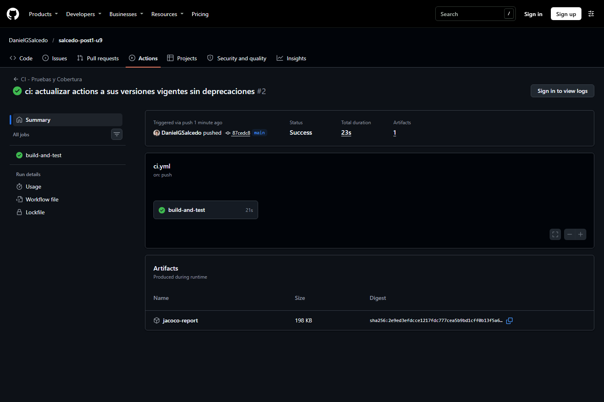

# Recordatorios Citas Service


**Post-contenido — Unidad 9: Probar el Diseño: JUnit 5, Mockito, Test Doubles e Integración Continua**

Microservicio Spring Boot que envía recordatorios de citas médicas por el canal preferido del
paciente (correo o SMS), construido con **Strategy** y **Factory Method** inyectados por
constructor, probado con JUnit 5, Mockito, H2 y un pipeline de GitHub Actions.

> Repositorio: <https://github.com/DanielGSalcedo/salcedo-post1-u9>
>
> El proyecto apunta a **Java 21** y usa Spring Boot 3.5.16 (línea 3.x). El entorno local de
> desarrollo dispone de JDK 25; el pipeline de CI compila y ejecuta las pruebas con JDK 21.

---

## 1. Descripción

El servicio revisa qué citas ocurren dentro de las próximas 24 horas y aún no han sido
notificadas, y envía un recordatorio por el canal preferido del paciente. Además, expone una
funcionalidad de recordatorio urgente para una cita concreta.

- **Strategy:** `ReminderChannel` define el contrato de envío; `EmailReminderChannel` y
  `SmsReminderChannel` son implementaciones intercambiables.
- **Factory Method:** `ReminderChannelFactory` selecciona la estrategia según
  `CanalNotificacion`.
- **DIP:** `CitaReminderServiceImpl` recibe repositorio, factory, canal urgente y `Clock` por
  constructor; no construye colaboradores con `new`.
- **Test doubles:** mocks de Mockito para repositorio/factory/canales y un **fake real** del
  JDK (`Clock.fixed`) para el reloj.
- **Integración:** `@DataJpaTest` con H2 y `@SpringBootTest` con contexto completo, reloj fijo
  y gateway de SMS mockeado.
- **CI:** GitHub Actions ejecuta `mvn verify`, publica el reporte JaCoCo y muestra el badge en
  estado verde.

---

## 2. Estructura del proyecto

```text
salcedo-post1-u9/
├── pom.xml
├── README.md
├── .github/
│   └── workflows/
│       └── ci.yml
├── docs/
│   ├── evidencias.md
│   └── capturas/
│       ├── pruebas-verdes.png
│       ├── cobertura.png
│       └── ci-success.png
└── src/
    ├── main/java/com/clinica/recordatorios/
    │   ├── RecordatoriosCitasServiceApplication.java
    │   ├── domain/
    │   │   ├── Cita.java
    │   │   └── CanalNotificacion.java
    │   ├── repository/
    │   │   └── CitaRepository.java
    │   ├── channel/
    │   │   ├── ReminderChannel.java
    │   │   ├── EmailReminderChannel.java
    │   │   ├── SmsReminderChannel.java
    │   │   ├── ReminderChannelFactory.java
    │   │   ├── ReminderChannelFactoryImpl.java
    │   │   └── gateway/
    │   │       ├── NotificadorSmsGateway.java
    │   │       └── TwilioNotificadorSmsGateway.java
    │   ├── service/
    │   │   ├── CitaReminderService.java
    │   │   ├── CitaReminderServiceImpl.java
    │   │   └── CitaNoEncontradaException.java
    │   └── config/
    │       ├── ClockConfig.java
    │       └── CanalUrgenteConfig.java
    └── test/java/com/clinica/recordatorios/
        ├── service/
        │   └── CitaReminderServiceImplTest.java
        ├── repository/
        │   └── CitaRepositoryTest.java
        └── CitaReminderServiceIntegrationTest.java
```

---

## 3. Parte 1 — Pruebas unitarias con JUnit 5 y Mockito

`CitaReminderServiceImplTest` aísla por completo el servicio de sus colaboradores:

| # | Prueba | Qué demuestra |
|---|---|---|
| 1 | `enviarRecordatoriosPendientes_citaEnVentana_usaElCanalPreferido` | Selecciona el canal EMAIL, envía, marca la cita y guarda |
| 2 | `enviarRecordatoriosPendientes_ventanaDeterministaSegunClockFijo_consultaLosLimitesExactos` | La ventana consultada es exactamente `[09:00, 09:00+24h]` gracias al fake |
| 3 | `enviarRecordatoriosPendientes_sinCitasPendientes_noConsultaLaFactory` | Sin citas no hay interacción con la factory ni `save()` |
| 4 | `enviarRecordatorioUrgente_citaExistente_usaCanalUrgenteInyectado` | Usa el canal urgente inyectado y persiste |
| 5 | `enviarRecordatorioUrgente_gatewayFalla_noMarcaComoEnviado` | Si el gateway falla, la cita no se marca ni se guarda |
| 6 | `enviarRecordatorioUrgente_citaInexistente_lanzaCitaNoEncontradaException` | Lanza la excepción de dominio y no toca el canal |

### 3.1 Elección justificada de Test Doubles

| Colaborador | Double elegido | Justificación |
|---|---|---|
| `CitaRepository` | **Mock** | No basta con que `findBy...` devuelva una lista: la prueba debe verificar que `save()` se invoca exactamente una vez y con la cita marcada como enviada. Importa controlar la respuesta **y** verificar la interacción. |
| `ReminderChannelFactory` / `ReminderChannel` | **Mock** | El comportamiento bajo prueba es la selección de estrategia y el uso del canal. Eso solo se observa verificando interacciones: `obtenerCanal(EMAIL)` y `enviar(cita, mensaje)`. |
| `Clock` | **Fake** (`Clock.fixed`) | `Clock.fixed(...)` es una implementación real, completa y determinista del JDK. Mockearla obligaría a stubbear `instant()` y `getZone()` por separado, y `LocalDateTime.now(clock)` dejaría de comportarse como un `Clock` real. El fake es más simple y más fiel. |

**Sin Strategy sería más difícil:** la lógica de correo/SMS estaría dentro del servicio y
probar la selección exigiría mockear clientes SMTP/HTTP de bajo nivel. Con `ReminderChannel`,
un solo mock de la interfaz permite verificar cualquier canal.

**Sin Factory sería más difícil:** el `switch` estaría embebido en el servicio y la selección
solo sería observable indirectamente (por una impresión o un efecto externo). Con la factory
inyectada, la decisión se verifica como una interacción explícita.

---

## 4. Parte 2 — Refactor DIP, integración y CI/CD

### 4.1 El problema: `new` hardcodeado

La primera versión de `enviarRecordatorioUrgente` construía sus dependencias dentro del método:

```java
ReminderChannel canalUrgente = new SmsReminderChannel(new TwilioNotificadorSmsGateway());
canalUrgente.enviar(cita, "URGENTE: ...");
```

Era imposible escribir una prueba unitaria para «el gateway falla y la cita no debe marcarse
como enviada»: no existía ningún punto de sustitución para insertar un mock. El problema era de
**diseño**, no de herramienta; `Mockito.mockConstruction()` habría ocultado la violación de DIP.

### 4.2 El refactor: construcción en el composition root

`CanalUrgenteConfig` es el único lugar donde se escribe `new` para este canal:

```java
@Bean
public ReminderChannel canalUrgente(NotificadorSmsGateway gateway) {
    return new SmsReminderChannel(gateway);
}
```

`CitaReminderServiceImpl` recibe la abstracción por constructor con `@Qualifier("canalUrgente")`:

```java
public CitaReminderServiceImpl(CitaRepository citaRepository,
                               ReminderChannelFactory reminderChannelFactory,
                               @Qualifier("canalUrgente") ReminderChannel canalUrgente,
                               Clock clock) { ... }
```

Después del refactor, la prueba del fallo del gateway es posible y pasa:

```java
doThrow(new RuntimeException("Gateway de SMS no disponible"))
    .when(canalUrgenteMock).enviar(any(), anyString());

assertThrows(RuntimeException.class,
    () -> citaReminderService.enviarRecordatorioUrgente(6L));

verify(citaRepository, never()).save(any());
assertFalse(cita.isRecordatorioEnviado());
```

**Antes:** imposible de testear en aislamiento. **Después:** el canal urgente se sustituye por
un mock y el escenario de fallo se verifica sin Twilio ni red.

### 4.3 Pruebas de integración

- `CitaRepositoryTest` (`@DataJpaTest`): guarda tres citas y verifica que la consulta devuelve
  solo la pendiente dentro de la ventana, excluyendo la ya enviada y la que está fuera.
- `CitaReminderServiceIntegrationTest` (`@SpringBootTest`): levanta el contexto completo,
  reemplaza el `Clock` por un bean `@Primary` con `Clock.fixed(...)` y usa `@MockBean` sobre
  `NotificadorSmsGateway`. Verifica el flujo completo: persistencia, selección del canal SMS,
  invocación del gateway y actualización de `recordatorioEnviado`.

**Por qué H2 real y gateway mockeado:** H2 es un fake aceptable porque su contrato SQL/JPA es
equivalente al de la base real y no requiere infraestructura. Un proveedor de SMS no tiene un
«H2 equivalente» gratuito y determinista; mockearlo evita credenciales, red y disponibilidad
externa en cada ejecución del pipeline.

### 4.4 Pipeline de CI

`.github/workflows/ci.yml` se ejecuta en `push` y `pull_request` sobre `main`:

1. Checkout del repositorio.
2. JDK 21 (Temurin) con caché de Maven.
3. `mvn -B verify --no-transfer-progress`.
4. Publicación del reporte JaCoCo como artefacto.

No se declara ningún servicio de base de datos porque las pruebas usan H2 en memoria. Eso
mantiene el pipeline simple, rápido y sin Docker.

---

## 5. Decisiones de diseño (resumen)

1. **`CitaRepository` como Mock, no Stub:** se necesita controlar el retorno y verificar
   `save()`; un stub no permitiría comprobar la interacción de persistencia.
2. **Factory y Channel como Mock:** el objetivo de la prueba es verificar que se selecciona y
   usa el canal correcto; el valor de retorno por sí solo no lo demuestra.
3. **`Clock` como Fake:** `Clock.fixed` es una implementación real del JDK; mockearla sería
   más complejo y menos fiel.
4. **Refactor DIP en `enviarRecordatorioUrgente`:** mover el `new` a `CanalUrgenteConfig` e
   inyectar `ReminderChannel` por constructor es lo que hace testeable el escenario de fallo
   del gateway. La testabilidad es consecuencia del diseño, no de una API de mocking avanzada.
5. **H2 + `@MockBean` del gateway en integración:** base real en memoria para persistencia,
   mock para el único colaborador externo no determinista.

---

## 6. Cómo ejecutar

Requisitos: JDK 21+ y Maven 3.9+.

```bash
# Compilar
mvn clean compile

# Ejecutar pruebas unitarias y de integración
mvn test

# Ejecutar pruebas y generar el reporte de cobertura
mvn verify

# Iniciar la aplicación (H2 en memoria)
mvn spring-boot:run
```

Reporte de cobertura: `target/site/jacoco/index.html`.

Resultado local: **8 pruebas, 0 fallos** (6 unitarias + 1 de repositorio + 1 de integración).

---

## 7. Evidencias

- Salidas completas: [`docs/evidencias.md`](docs/evidencias.md)
- Pruebas en verde: [`docs/capturas/pruebas-verdes.png`](docs/capturas/pruebas-verdes.png)
- Reporte de cobertura: [`docs/capturas/cobertura.png`](docs/capturas/cobertura.png)
- Pipeline en verde: [`docs/capturas/ci-success.png`](docs/capturas/ci-success.png)






Cobertura local: **77 % de instrucciones**, **82 % de líneas** y **75 % de ramas** (JaCoCo).

---

## 8. Historial de commits

| # | Commit | Parte |
|---|---|---|
| 1 | `chore: inicializar recordatorios-citas-service con configuracion base` | Base |
| 2 | `feat(domain): agregar entidad Cita, CanalNotificacion y CitaRepository` | Parte 1 |
| 3 | `feat(channel): implementar Strategy, Factory y gateway de SMS` | Parte 1 |
| 4 | `feat(service): implementar recordatorios pendientes con DIP y Clock inyectado` | Parte 1 |
| 5 | `test(service): agregar suite unitaria con JUnit 5, Mockito y Clock fijo` | Parte 1 |
| 6 | `refactor(service): inyectar canalUrgente por constructor para habilitar pruebas` | Parte 2 |
| 7 | `test(integration): agregar DataJpaTest y SpringBootTest con H2 y gateway mockeado` | Parte 2 |
| 8 | `ci: configurar pipeline de GitHub Actions con reporte de cobertura` | Parte 2 |
| 9 | `docs: completar README con decisiones de diseno, evidencias y badge` | Ambas |
| 10 | `ci: actualizar actions a sus versiones vigentes sin deprecaciones` | Parte 2 |
| 11 | `docs: agregar captura del pipeline en verde` | Ambas |

---

## 9. Conclusiones

La unidad demuestra que la calidad de las pruebas depende de la calidad del diseño: gracias a
Strategy y Factory, el servicio se prueba con mocks de interfaces propias en lugar de con
clientes SMTP o HTTP de bajo nivel; gracias a `Clock.fixed`, la ventana de 24 horas es exacta y
reproducible. El refactor de `enviarRecordatorioUrgente` evidencia que un `new` dentro de la
lógica de negocio no es solo un detalle de estilo: elimina todo punto de sustitución y hace
imposible probar escenarios de fallo. Mover la construcción al composition root y aplicar DIP
convirtió una funcionalidad no testeable en una cubierta por pruebas unitarias y de integración,
todo dentro de un pipeline que se ejecuta en cada push.
