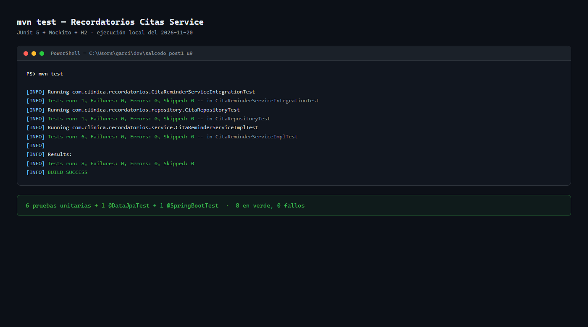
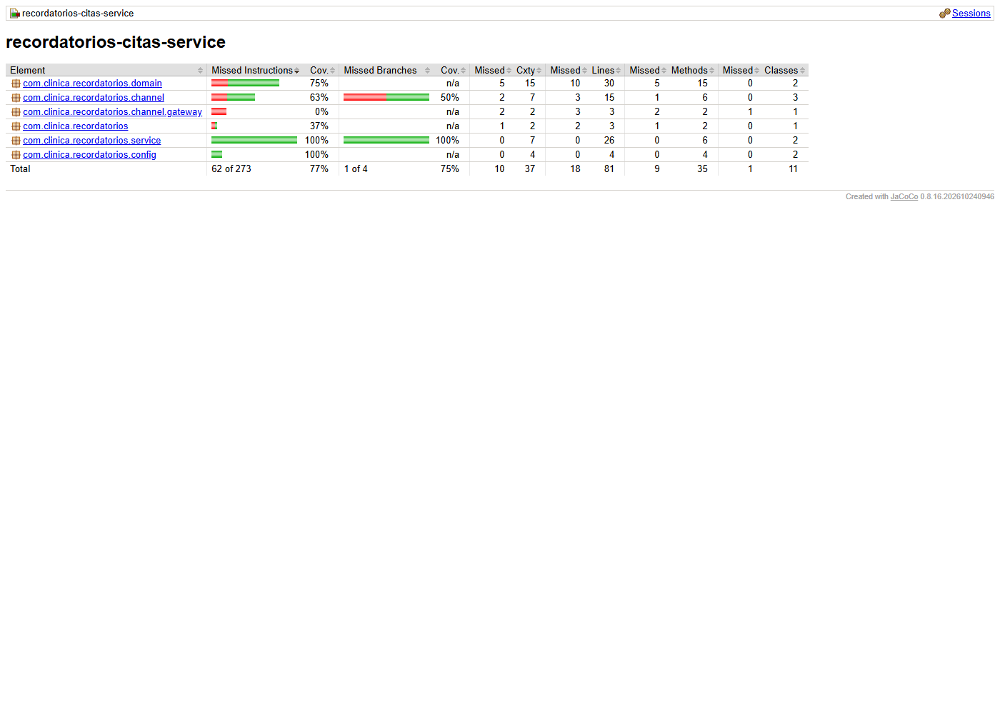
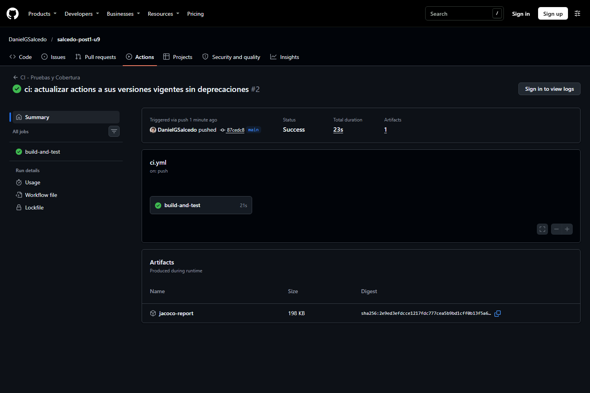

# Evidencias de ejecución — Post-contenido Unidad 9

Repositorio: <https://github.com/DanielGSalcedo/salcedo-post1-u9>

Todas las evidencias fueron producidas ejecutando el proyecto localmente con
`mvn verify` y, posteriormente, por el pipeline de GitHub Actions sobre `main`.

---

## 1. Pruebas ejecutadas

Comando:

```bash
mvn test
```

Salida resumida (8 pruebas, 0 fallos):

```text
[INFO] Running com.clinica.recordatorios.CitaReminderServiceIntegrationTest
[INFO] Tests run: 1, Failures: 0, Errors: 0, Skipped: 0
[INFO] Running com.clinica.recordatorios.repository.CitaRepositoryTest
[INFO] Tests run: 1, Failures: 0, Errors: 0, Skipped: 0
[INFO] Running com.clinica.recordatorios.service.CitaReminderServiceImplTest
[INFO] Tests run: 6, Failures: 0, Errors: 0, Skipped: 0
[INFO] Results:
[INFO] Tests run: 8, Failures: 0, Errors: 0, Skipped: 0
[INFO] BUILD SUCCESS
```

| Suite | Tipo | Pruebas |
|---|---|---|
| `CitaReminderServiceImplTest` | Unitaria (JUnit 5 + Mockito + `Clock.fixed`) | 6 |
| `CitaRepositoryTest` | `@DataJpaTest` con H2 | 1 |
| `CitaReminderServiceIntegrationTest` | `@SpringBootTest` + `@MockBean` | 1 |
| **Total** | | **8** |



---

## 2. Cobertura JaCoCo

Comando:

```bash
mvn verify
```

El reporte se genera en `target/site/jacoco/index.html` y se publica como artefacto
`jacoco-report` en cada ejecución del pipeline.

Totales del reporte:

| Métrica | Cubierto | Total | Cobertura |
|---|---|---|---|
| Instrucciones | 211 | 273 | **77 %** |
| Ramas | 3 | 4 | **75 %** |
| Líneas | 81 | 99 | **82 %** |
| Métodos | 35 | 44 | **80 %** |
| Clases | 11 | 12 | **92 %** |

Paquetes:

| Paquete | Instrucciones |
|---|---|
| `com.clinica.recordatorios.service` | 100 % |
| `com.clinica.recordatorios.config` | 100 % |
| `com.clinica.recordatorios.domain` | 75 % |
| `com.clinica.recordatorios.channel` | 63 % |
| `com.clinica.recordatorios.channel.gateway` | 0 % (adaptador Twilio, se mockea en pruebas) |
| `com.clinica.recordatorios` | 37 % (`main` de arranque) |

El paquete `channel.gateway` corresponde al adaptador real de Twilio: no se prueba
porque las pruebas sustituyen la interfaz `NotificadorSmsGateway`; su única
responsabilidad es delegar en el SDK externo.



---

## 3. Pipeline de GitHub Actions

Workflow: `.github/workflows/ci.yml`

```yaml
name: CI - Pruebas y Cobertura

on:
  push:
    branches: [ main ]
  pull_request:
    branches: [ main ]

jobs:
  build-and-test:
    runs-on: ubuntu-latest
    steps:
      - uses: actions/checkout@v4
      - uses: actions/setup-java@v4
        with:
          java-version: "21"
          distribution: "temurin"
          cache: maven
      - run: mvn -B verify --no-transfer-progress
      - uses: actions/upload-artifact@v4
        with:
          name: jacoco-report
          path: target/site/jacoco
```

Cada push a `main` compila con JDK 21, ejecuta las 8 pruebas, genera el reporte
JaCoCo y lo publica como artefacto descargable.

### Estado del pipeline

- Badge: 
- Ejecuciones: <https://github.com/DanielGSalcedo/salcedo-post1-u9/actions/workflows/ci.yml>


